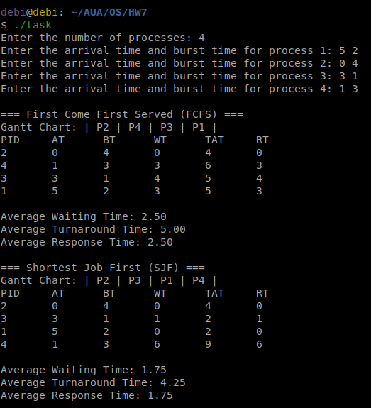

# HW7: Process Scheduling Simulation (FCFS & SJF)

A process scheduling simulator in C that runs the same set of processes through two non-preemptive algorithms:

- **FCFS (First Come First Served):** processes run in order of arrival time (ties broken by PID).
- **SJF (Shortest Job First):** among the processes that have already arrived, the one with the shortest burst time runs next (ties broken by earlier arrival time, then by PID).

For each algorithm the program prints the Gantt chart, a table with waiting time (WT), turnaround time (TAT) and response time (RT) for every process, and the averages. If no process has arrived yet, the CPU is idle and the Gantt chart shows an `IDLE` block.

## Files

- `task.c`: source code
- `task.png`: screenshot of a sample run

## Compile

```bash
gcc task.c -o task
```

## Run

```bash
./task
```

Enter the number of processes, then the arrival time and burst time of each process, separated by a space:

```
Enter the number of processes: 4
Enter the arrival time and burst time for process 1: 5 2
Enter the arrival time and burst time for process 2: 0 4
Enter the arrival time and burst time for process 3: 3 1
Enter the arrival time and burst time for process 4: 1 3
```

The input can also be passed through a pipe instead of being typed:

```bash
printf "4\n5 2\n0 4\n3 1\n1 3\n" | ./task
```

Invalid input (a non-positive number of processes, a negative arrival time, or a burst time of 0 or less) is rejected and the program exits with code 1.

## Example input and output



The processes are entered out of arrival order. FCFS sorts them by arrival time and runs P2, P4, P3, P1.

SJF runs P2 first, because it is the only process present at t=0. At t=4, P4 (burst 3) and P3 (burst 1) have arrived, so P3 runs. At t=5, P1 (burst 2) has arrived and runs before P4. P4 arrived second but runs last, which gives SJF a lower average waiting time (1.75 vs 2.50).
